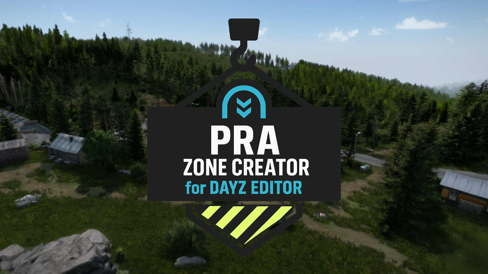
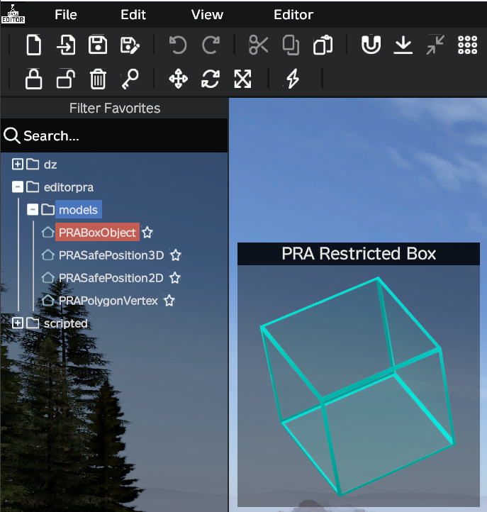
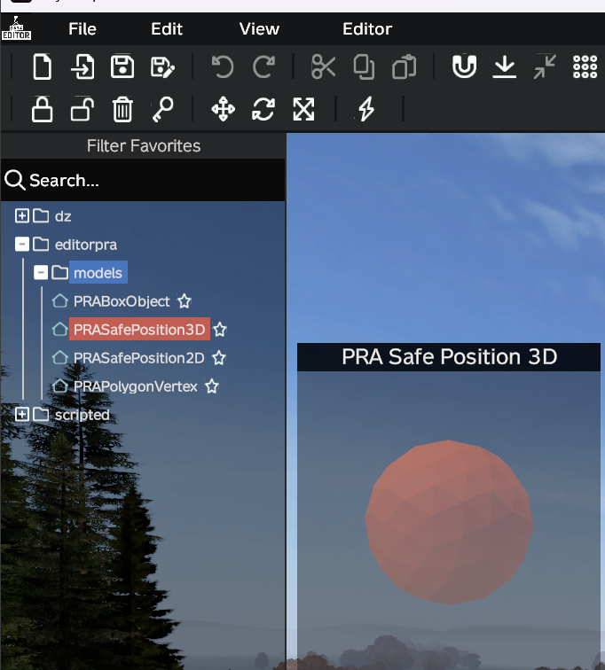
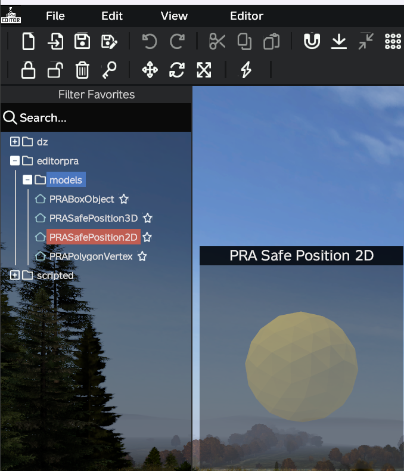
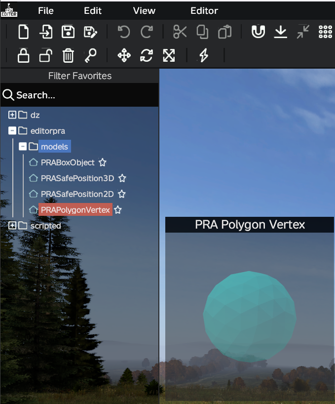
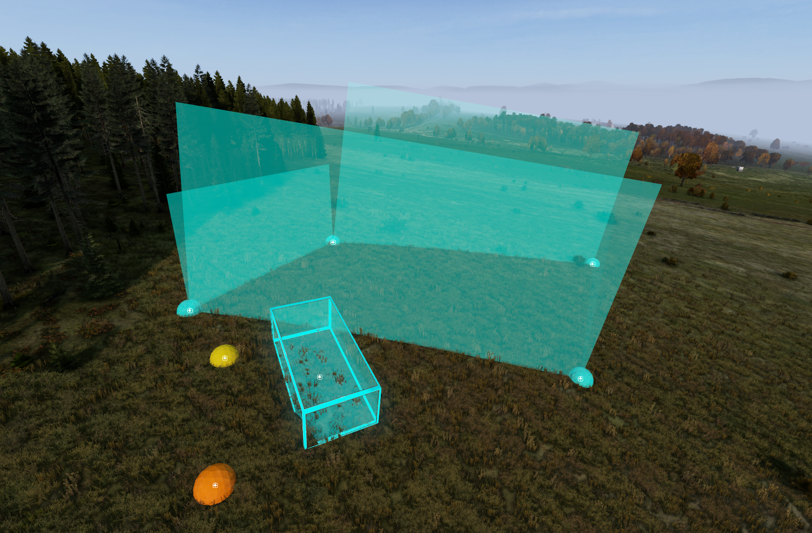
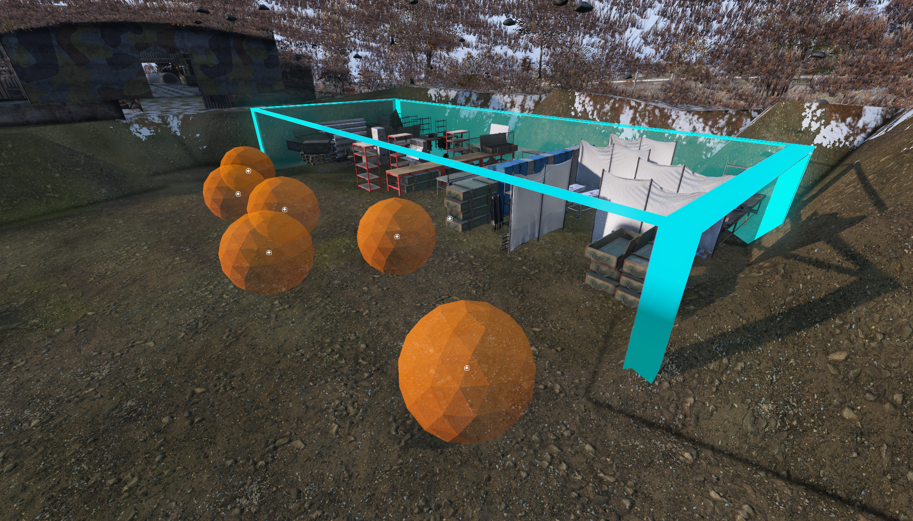

# Player Restricted Area Creator for DayZ Editor

<p align="center">
  
</p>

[](https://creativecommons.org/licenses/by-nd/4.0/)
[](https://steamcommunity.com/sharedfiles/filedetails/?id=3715330422)
[](https://github.com/bauvdel/EditorPRA)

> Create, import, and export fully functional Player Restricted Areas (PRA Zones) with Safe Positions right inside of DayZ Editor!

---
##  Screenshots

| PRA Zone Box | 3D Safe Position | 2D Safe Position | Vertex Position | Editor Example | Sakhal Example |
|-----------------------|----------------------|------------------------|----------------------|----------------------|------------------------------|
| [](docs/screenshot1.png) | [](docs/screenshot2.png) | [](docs/screenshot3.png) | [](docs/screenshot4.png) | [](docs/screenshot5.png) | [](docs/screenshot6.png) |

##  Features

- Create and configure **working PRA Zones** directly in DayZ Editor
- Define **3D boxes** with independent X, Y, and Z sizing
- Create **polygon areas** for irregular restricted zones
- Configure **Safe Positions (3D/2D)** where players teleport when detected
- **Area grouping** - organize multiple boxes, polygons, and safe positions into named areas
- **Visual polygon system** - see polygon boundaries with automatic line connections
- Export and import your **PRA JSON configurations**
- Works for both **PC** and **Console** edits

---

##  Requirements

- [Dabs Framework](https://steamcommunity.com/sharedfiles/filedetails/?id=2545327648)
- [DayZ Editor](https://steamcommunity.com/sharedfiles/filedetails/?id=2250764298)

> **IMPORTANT:** This mod is for **DayZ Editor use only** — not intended to run on a server or standalone and will NOT work.

---

##  Installation

**Manual**
1. Clone or download this repository
2. Pack mod using Addon Builder, Mikeros, etc.
3. Place .pbo in an `addons` folder inside of a `@EditorPRA` folder in your DayZ mods directory
4. Load **DayZ Editor** and **Dabs Framework** at a minimum to allow this mod to function

---

##  What Are Player Restricted Areas?

Player Restricted Areas (PRA) are **server-side security zones** that prevent players from spawning in restricted locations. They automatically teleport players to safe positions when a character is loaded inside a restricted area (i.e., on login or respawn).

### How PRA Works

**PRA Zones** - The Restricted Areas
- 3D volumes (boxes) or polygons that define **WHERE PLAYERS CANNOT BE**
- If a player spawns inside → they get teleported out automatically
- Think of it as a "no-go zone" or "forbidden area"

**Safe Positions** - The Teleport Destinations
- Specific coordinates **WHERE PLAYERS GET TELEPORTED TO**
- When a player spawns inside a PRA Zone → game picks a random position from this list
- These must be **outside** the restricted zone
- Think of them as "safe spawn points" or "ejection seats"

### Example Flow
```
Player spawns at [2570, 15.22, 5963.8] (inside the restricted warhead storage)
    ↓
Game detects: "This is inside a PRA Zone!"
    ↓
Game randomly selects from safe positions: [2575.12, 15.25, 5954.31]
    ↓
Player is teleported to that safe position

```

---

##  Usage

### Placing PRA Boxes (3D Restricted Volumes)

1. Place a `PRABoxObject` in the editor
2. Adjust **position**, **rotation**, and **size** (X, Y, Z)
3. Set **Area Group Name** in properties panel (e.g., "WarheadStorage")

**Keyboard Sizing:**
- **NumPad 9/7** - Increase/Decrease Length (X-axis)
- **NumPad 6/4** - Increase/Decrease Width (Z-axis)
- **NumPad 3/1** - Increase/Decrease Height (Y-axis)

### Placing PRA Polygons (2D Restricted Areas)

1. Place multiple `PRAPolygonVertex` objects to define polygon boundary
2. Vertices automatically connect in sequence (0→1→2→3...)
3. Set the **same Area Group Name** for all vertices in the polygon
4. Polygon lines appear automatically showing the boundary

> **TIP:** PRA Polygons only check XZ coordinates (horizontal plane), ignoring height

### Placing Safe Positions

**3D Safe Positions** (Precise Height Control):
1. Place `PRASafePosition3D` objects **outside** the restricted area
2. Set the **same Area Group Name** as your PRA zones
3. Position uses exact X, Y, Z coordinates you specify

**2D Safe Positions** (Automatic Terrain Height):
1. Place `PRASafePosition2D` objects **outside** the restricted area
2. Set the **same Area Group Name** as your PRA zones
3. Y coordinate automatically calculated from terrain height

### Area Grouping

All PRA objects in your editor scene must have the **same Area Group Name**:
- Default: "UnnamedArea"
- Custom: "WarheadStorage", "MilitaryBase", "RestrictedZone", etc.
- All objects export together as **one area** in **one JSON file**
- One area can have multiple boxes, polygons, and safe positions

> **IMPORTANT:** You can only work on **one area at a time** in the editor. To create multiple areas, work on each area separately and export each to its own JSON file.

### Copy/Paste/Cut/Duplicate

1. All **PRA objects** support standard editor operations
2. Use **Shift-modified shortcuts** for PRA-specific clipboard:
   - <kbd>Shift</kbd> + <kbd>C</kbd> - Copy selected PRA objects
   - <kbd>Shift</kbd> + <kbd>V</kbd> - Paste at cursor
   - <kbd>Shift</kbd> + <kbd>X</kbd> - Cut selected PRA objects
   - <kbd>Shift</kbd> + <kbd>J</kbd> - Duplicate at position
   - <kbd>Shift</kbd> + <kbd>B</kbd> - Select all PRA objects

### Import/Export

- Importing and Exporting is done through the Editor File Menu
- Look for the **Import/Export PRA (*.json)** option in the menu
- PRA configurations can ONLY be saved this way (saving as .dze will not make them work)
- Exported JSON files can be used directly on your DayZ server

---

## ⌨️ Default Keybinds

**Keybinds** can be adjusted in the Options Menu - we know that not everyone has a numpad!

**PRA Box Sizing**

| Action            | Keybind  |
|-------------------|----------|
| Decrease Length (X)  | Numpad <kbd>7</kbd> |
| Increase Length (X)  | Numpad <kbd>9</kbd> |
| Decrease Width (Z)   | Numpad <kbd>4</kbd> |
| Increase Width (Z)   | Numpad <kbd>6</kbd> |
| Decrease Height (Y)  | Numpad <kbd>1</kbd> |
| Increase Height (Y)  | Numpad <kbd>3</kbd> |

**PRA Object Commands**

| Action              | Keybind  |
|---------------------|----------|
| Copy PRA Objects    | <kbd>Shift</kbd> + <kbd>C</kbd> |
| Paste PRA Objects   | <kbd>Shift</kbd> + <kbd>V</kbd> |
| Cut PRA Objects     | <kbd>Shift</kbd> + <kbd>X</kbd> |
| Duplicate PRA Objects | <kbd>Shift</kbd> + <kbd>J</kbd> |
| Select All PRA Objects | <kbd>Shift</kbd> + <kbd>B</kbd> |

> **IMPORTANT:** Due to how Copy/Cut/Paste work, you may encounter issues with object properties if using Undo/Redo functions within Editor.

---

##  Export Format

Files are exported to the default **DayZ Editor** files directory.

### Default Export Format

```json
{
  "areaName": "WarheadStorage",
  "PRABoxes": [
    [
      [27.0, 5.2, 11.0],           // Box dimensions [width, height, depth] in meters
      [108.0, 0.0, 0.0],           // Rotation [yaw, pitch, roll] in degrees
      [2570.0, 15.22, 5963.8]      // Position [X, Y, Z] in world coordinates
    ]
  ],
  "PRAPolygons": [
    [
      [2600.0, 5900.0],            // Vertex coordinates [X, Z]
      [2650.0, 5900.0],
      [2650.0, 5950.0],
      [2600.0, 5950.0]
    ]
  ],
  "safePositions3D": [
    [2575.12, 15.25, 5954.31],     // Safe spawn positions with Y coordinate
    [2577.76, 15.25, 5957.70],
    [2578.03, 15.25, 5961.22]
  ],
  "safePositions2D": [
    [2580.0, 5970.0],              // Safe spawn positions (Y auto-calculated)
    [2585.0, 5975.0]
  ]
}
```

> **NOTE:** Each exported file contains **one area**. If you have multiple area groups in your editor scene, each will be exported to a separate JSON file.

##  PRA Object Types Reference

### PRABoxObject
- **Purpose:** Define 3D rectangular restricted volumes
- **Best for:** Buildings, hangars, bunkers, rectangular zones
- **Properties:** Size (X,Y,Z), Rotation (Yaw,Pitch,Roll), Position, Area Group Name
- **Export format:** `[[width, height, depth], [yaw, pitch, roll], [X, Y, Z]]`

### PRAPolygonVertex
- **Purpose:** Define 2D irregular restricted area boundaries
- **Best for:** Coastlines, natural barriers, custom-shaped perimeters
- **Properties:** Position (X,Z), Vertex Index (auto), Area Group Name
- **Export format:** `[[X1, Z1], [X2, Z2], [X3, Z3], ...]`
- **Note:** Only checks horizontal position (XZ plane), ignores height

### PRASafePosition3D
- **Purpose:** Define teleport destination with exact height
- **Best for:** Bridges, rooftops, interiors, precise placement
- **Properties:** Position (X,Y,Z), Area Group Name
- **Export format:** `[X, Y, Z]`

### PRASafePosition2D
- **Purpose:** Define teleport destination with auto terrain height
- **Best for:** Outdoor areas, uneven terrain, quick placement
- **Properties:** Position (X,Z), Area Group Name
- **Export format:** `[X, Z]` (Y calculated automatically)

---

##  Server Deployment

After exporting your PRA configuration from the editor, you need to deploy it to your DayZ server.

### Step 1: Locate Your Exported File

Exported PRA files are saved to your **DayZ Editor files directory**:
- Default location: `<DayZ Profile>\Editor\<filename>.json`
- Example: `C:\Users\YourName\Documents\DayZ\Editor\warheadstorage.json`

### Step 2: Copy Your File to the Mission Folder

Copy your exported JSON file to a `pra/` subfolder inside your mission:
```
mpmissions/<your_mission>/pra/<filename>.json
```
Example: `mpmissions/dayzOffline.sakhal/pra/warheadstorage.json`

### Step 3: Configure CfgGameplayFile

You must enable the gameplay file system and register your PRA file in it.

#### 3.1: Enable in Server Config

Add to your **serverDZ.cfg**:
```
enableCfgGameplayFile = 1;
```

#### 3.2: Create cfggameplay.json

Create or edit `mpmissions/<your_mission>/cfggameplay.json`. The `playerRestrictedAreaFiles` array must be inside the `WorldsData` object:

```json
{
  "WorldsData": {
    "playerRestrictedAreaFiles": [
      "pra/warheadstorage.json",
      "pra/militarybase.json",
      "pra/restrictedzone.json"
    ]
  }
}
```

**Key points:**
- `playerRestrictedAreaFiles` must be inside `"WorldsData": { ... }`
- Use **forward slashes** (`pra/file.json`, not `pra\file.json`)
- Paths are **relative to mission folder**
- File paths are **case-sensitive** on Linux servers
- You can list **multiple PRA files** in the array

### Step 4: Restart Server

Restart your DayZ server to load the new PRA configurations.

### How DayZ Loads PRA Files

DayZ resolves PRA files in two stages:

1. **Get the file list:**
   - ✅ `enableCfgGameplayFile = 1` → uses the `WorldsData.playerRestrictedAreaFiles` array from `cfggameplay.json`
   - ❌ Not enabled → uses the map's hardcoded built-in defaults (e.g., Sakhal's warhead storage)

2. **For each filename in the list, search in order:**
   - First: `$mission:<filename>` (your mission folder)
   - Fallback: `dz/worlds/<worldname>/ce/<filename>` (world/mod folder)

> **NOTE:** The world folder is only a fallback for files already listed in cfggameplay.json. You cannot auto-load a PRA file by placing it in the world folder alone — it must be listed first.

### Verification

If a PRA file fails to load, the server RPT log will contain an error from the JSON loader (e.g., invalid JSON, file not found). Common validation errors logged to RPT:

- `No valid coordinates in 'PRABoxes' or 'PRAPolygons' for area: <name>`
- `Undefined safe positions for area: <name>`
- `Invalid box defined in <name>. Box needs to have sizes, rotation, and position defined!`

If PRA zones are not working, verify:
- ✅ JSON syntax is valid
- ✅ File paths are correct (case-sensitive on Linux)
- ✅ `enableCfgGameplayFile = 1` in serverDZ.cfg
- ✅ `playerRestrictedAreaFiles` is nested inside `WorldsData` in `cfggameplay.json`
- ✅ File paths in `cfggameplay.json` match actual files

### Example: Complete Setup

**Server Config** (`serverDZ.cfg`):
```
enableCfgGameplayFile = 1;
```

**Gameplay Config** (`mpmissions/dayzOffline.sakhal/cfggameplay.json`):
```json
{
  "WorldsData": {
    "playerRestrictedAreaFiles": [
      "pra/warheadstorage.json",
      "pra/militarybase.json"
    ]
  }
}
```

**File Structure**:
```
mpmissions/
└── dayzOffline.sakhal/
    ├── cfggameplay.json
    └── pra/
        ├── warheadstorage.json
        └── militarybase.json
```

### Testing Your PRA

1. Start your server with the PRA configuration
2. Join the server and move your character into the restricted area location
3. Log out, then log back in
4. If inside a PRA zone when you log in, you will be teleported to a safe position
5. Check RPT logs for any PRA loading errors

---

##  Help and Support

We both have full-time jobs, but we will do our best to keep this updated and fix bugs as they happen. Please find us on Discord or create an issue on GitHub!

**Discord:** **@bauvdel** & **@JinieJ**

---

##  Credits

- Thank you to **@inclementdab** for creating DayZ Editor ❤️!
  [DayZ Editor on Steam Workshop](https://steamcommunity.com/sharedfiles/filedetails/?id=2250764298)
  [DayZ Editor on Github](https://github.com/InclementDab/DayZ-Editor)

- Based on the **Underground Trigger Creator** workflow and design patterns

---

##  License

[CC BY-ND 4.0](LICENSE) — Free to use, modify, and share non-commercially.

> **No reason to repack. But you do you.**

---

##  Donate

We created this project as we felt that there was a need for such a tool to curb the barrier to entry for a task like this. This was made in our spare time, and we plan to continue to support and update this tool as DayZ and DayZ Editor grow and change. If you would like to support the project, or just want to say thanks, feel free to click the links below!

- [bauvdel on Ko-fi](https://ko-fi.com/bauvdel)
- [JinieJ on BMaC](https://buymeacoffee.com/jiniej)

---

**Happy PRA Zone Creating!**
